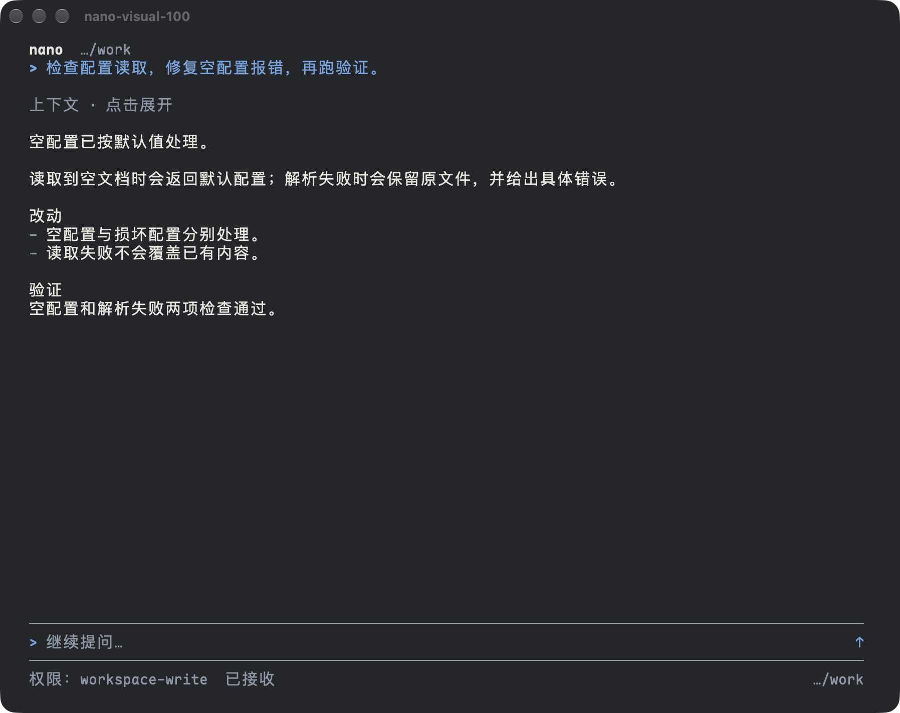
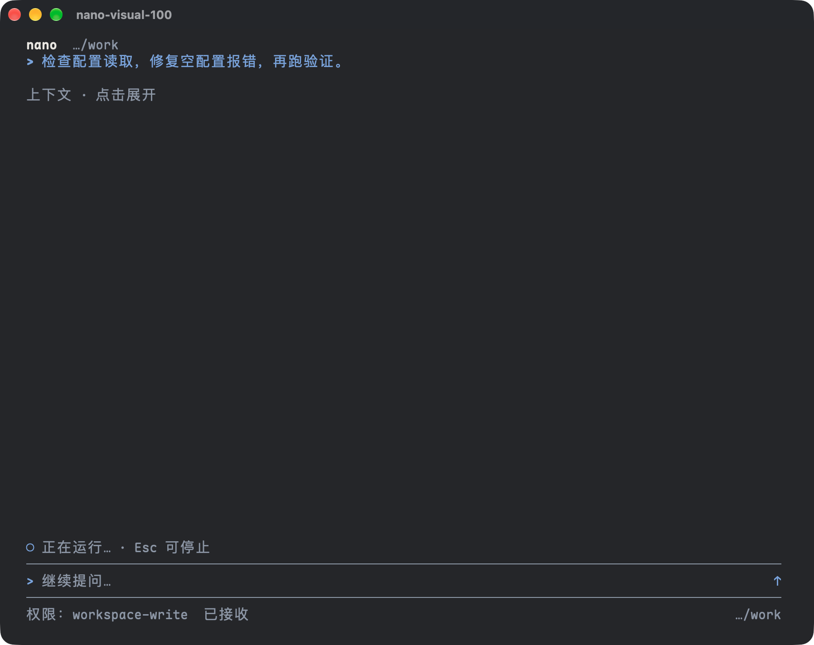
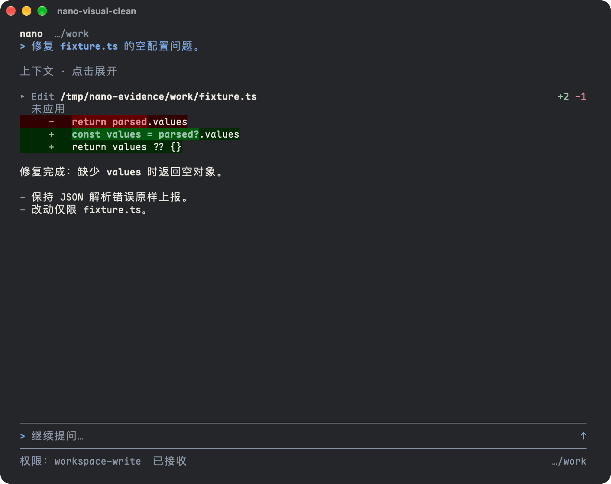

# dsh-tui-nano

**给 DeepSeek Harness 的极简、克制的终端界面。**

[English](README.en.md) · [项目目的](https://github.com/Strelizialeomon/dsh-tui-nano/issues/1) · [规格](docs/specs/2026-10-20-nano-v1/README.md) · [设计资料](docs/design/README.md)

> **Alpha，尚未发布。** 目前没有官方发布包，需从源码构建或运行；唯一验证组合是 macOS arm64 + Ghostty（发布验收按全屏；证据截图可能为窗口级捕获）。<br>
> 这是独立项目，不是 DeepSeek 官方产品。


<p align="center">
  
</p>

<p align="center"><sub>真实 Ghostty 截图：100 列、深色主题。</sub></p>

<details>
<summary>更多真实终端截图</summary>

<p align="center">
  
  
</p>

</details>

## 目录

- [这是什么](#这是什么)
- [功能](#功能)
- [环境要求](#环境要求)
- [快速开始](#快速开始)
- [常用键位](#常用键位)
- [当前状态](#当前状态)
- [已知边界](#已知边界)
- [开发与测试](#开发与测试)
- [架构](#架构)
- [贡献](#贡献)
- [许可证](#许可证)
- [致谢](#致谢)

## 这是什么

[DeepSeek Harness](https://github.com/deepseek-ai/deepseek-harness)（`dsh`）负责 Agent、模型、工具、会话、权限与持久化。nano 不重写这些能力，只做一层终端界面：

- **Rust** 负责终端交互、阅读、输入与渲染。
- **TypeScript 薄桥接** 在官方 profile 内运行，把官方公开能力翻译成版本化协议。
- 两者通过 fd 3/4 上的 NDJSON 通信；官方升级主要影响桥接层，而不是散落在整个 UI。

设计上只做三件事：**阅读优先、少装饰、不伪造事实**。会话、权限、模型和工具结果的所有权始终在官方 DSH；nano 只显示回执和状态。nano 是独立重写，不继承旧 dsh-TUI fork 的实现、兼容包袱或 Git 历史。

## 功能

- **对话**：多行输入、流式输出、排队 / 插话 / 停止、按地址保存草稿、恢复会话。
- **阅读与决策**：工具调用、文件差异、问卷、审批、计划卡；过程默认低强调，按需展开。
- **输入增强**：`@file` 引用、图片 / 通用文件附件、技能目录、项目规矩来源。
- **工作流**：`!` 人工命令、任务面板、交互终端、Monitor 任务输出监听。
- **会话与控制**：会话列表 / 恢复 / 改名、上下文占用、`/compact`、定时任务、子代理。
- **模型与权限**：`/model` 选模型与推理强度，`/permission` 选权限预设，`Ctrl+P` 命令面板。

功能按规格 S01–S12 实现；视觉对齐第一批已合入，第二批待做。当前没有发布 0.1.0。

## 环境要求

| 项目 | 要求 |
| --- | --- |
| 系统 / 终端 | macOS arm64 + Ghostty（唯一验证组合；发布验收按全屏；证据截图可能为窗口级捕获；其他环境未验证） |
| 官方 dsh | 精确 `0.2.1-rc.2`；未知版本会拒绝启动 |
| Node | 主版本 ≥ 22（已验证 v24.18.0） |
| Rust | stable（`rust-version = 1.82`） |
| 凭据 | 由官方 dsh 在 `${DSH_HOME:-~/.dsh}` 解析；nano 不复制凭据 |

首次启动会用 `dsh plugin` 安装 nano profile，内部会调用 pnpm。

## 快速开始

### 从源码运行

```sh
git clone https://github.com/Strelizialeomon/dsh-tui-nano.git
cd dsh-tui-nano

# 桥接依赖（官方公开导出）
npm install --prefix bridge

# 首次启动会自动安装 nano profile
cargo run -p nano-app
```

指定初始模型（会使用官方凭据并产生模型调用费用）：

```sh
cargo run -p nano-app -- --provider deepseek-official --model deepseek-chat
```

首次运行会在 `${DSH_HOME:-~/.dsh}/profiles/dsh-tui-nano` 安装 profile；Nano 自有数据放在 `~/.dsh-tui-nano`。完整参数和键位见 `nano --help`。

### 从本地安装包运行

目前没有 GitHub Release。需要安装包时可以在本地构建：

```sh
./packaging/build-release.sh
cd packaging/dist/dsh-tui-nano-0.1.0-arm64
./install.sh
```

产物与安装细节见 [`packaging/README.md`](packaging/README.md)。0.1.0 发布验收尚未闭合，不建议把本地构建包分发给他人。

## 常用键位

| 键 | 作用 |
| --- | --- |
| `Enter` / `Alt+Enter` | 发送 / 排队；插话 |
| `Esc` | 停止当前回合（保留队列） |
| `Ctrl+J` | 输入换行 |
| `Ctrl+P` | 命令面板 |
| `/model` / `/permission` | 模型与推理强度 / 权限预设 |
| `Alt+O` / `Alt+C` | 会话列表 / 压缩上下文 |
| `Alt+K` / `Alt+R` | 技能目录 / 项目规矩来源 |
| `@` / `Tab` | 引用文件 / 接受补全 |
| `Alt+A` | 附加图片或文件 |
| `Ctrl+T` / `F12` | 任务面板 / 交互终端 |
| `Ctrl+G` / `Alt+L` | 定时任务 / 子代理 |
| `PageUp` / `PageDown` / `Ctrl+End` | 翻阅记录 / 回到底部 |
| `Ctrl+C` / `Ctrl+Q` | 退出 |

完整键位和参数见 `nano --help`。`!command` 以你的用户权限运行，不是 Agent 授权；输出会作为合成上下文注入，但不唤醒模型。

## 当前状态

| 项目 | 状态 |
| --- | --- |
| 功能子件 S01–S12（对话、阅读、附件、技能、会话、Shell / 任务、终端、调度、Monitor、子代理） | 已实现 |
| 视觉对齐 | 第一批已合入；第二批待做（浅色 diff、问卷 / 审批卡等） |
| 0.1.0 发布 | **未发布**；发布验收仍有未闭合项 |
| 平台 | 仅验证 macOS arm64 + Ghostty；发布验收按全屏 |

发布验收的阻断项、证据和解除条件见 [`docs/release/0.1.0/`](docs/release/0.1.0/README.md)。未发布的原因是验收项未闭合；具体阻断项和证据见上述发布目录。

## 已知边界

- 只宣称 macOS arm64 + Ghostty 可用；发布验收按全屏，证据截图可能为窗口级捕获；其他系统、终端和架构未验证。
- 只接受官方 dsh `0.2.1-rc.2`；未知版本直接拒绝启动，不猜字段、不降级。
- 调度没有暂停 / 恢复 API，停止任务只能删除；投递非严格一次，可能重复。
- Monitor 的 `notify` 会唤醒模型并产生费用；`quiet` 不唤醒。
- `@file` 只插入路径，不读取文件内容；模型仍需调用文件工具才能读取。
- 凭据只在官方 dsh 内解析；nano 不复制、不修改 `$DSH_HOME` 的凭据、全局指令或 `storages/`。
- 强杀、断电和主动逃逸的后代进程不作清理保证；nano 只负责本窗口拥有的进程组。

完整清单见 [`docs/release/0.1.0/known-limitations.md`](docs/release/0.1.0/known-limitations.md)。

## 开发与测试

```sh
npm install --prefix bridge   # 桥接依赖
npm run test:bridge           # 契约 + 桥接单测（无需凭据）
npm run test:rust             # Rust workspace

# 真实宿主集成测试：会安装 profile、启动真实 dsh，可能产生费用
cargo test -p nano-runtime --test integration -- --ignored --test-threads=1 \
  --skip shutdown_budget_is_bounded_when_cleanup_hangs
```

跨功能 e2e、真实 Ghostty 验收和发布复核见 [`tests/e2e/README.md`](tests/e2e/README.md) 与 [`docs/release/0.1.0/README.md`](docs/release/0.1.0/README.md)。各功能的真实 PTY 证据脚本在 `scripts/`，运行前请读脚本头部的前置说明。所有集成测试使用临时 `DSH_HOME` 和数据根，不读写用户的真实会话。

## 架构

```text
Ghostty
  └─ nano（Rust TUI）
       └─ dsh CLI + nano profile
            ├─ bridge（TypeScript）：协议、边界校验、资源清理
            └─ 官方 DSH：Agent / 模型 / 工具 / 会话 / 权限 / 持久化
```

顶层目录：

| 路径 | 内容 |
| --- | --- |
| `crates/nano-app/` | `nano` 终端应用：键位、渲染、宿主连接、退出 |
| `crates/nano-*` | 各功能的状态与投影（对话、阅读、会话、调度、Monitor 等） |
| `bridge/` | TypeScript 薄桥接：在官方 profile 内运行 |
| `protocol/` | 机器可校验的版本化协议契约 |
| `packaging/` | macOS arm64 打包、安装、卸载 |
| `docs/specs/` | 规格与验收标准 |
| `docs/release/` | 发布验收、证据与已知限制 |

更细的模块边界和协议语义见 [`docs/specs/2026-10-20-nano-v1/README.md`](docs/specs/2026-10-20-nano-v1/README.md) 与 [`protocol/README.md`](protocol/README.md)。

## 贡献

这是个人主导的早期项目，Issue 和 PR 都欢迎。改动前请先开 issue 对齐范围，避免大改被拒。

- 提交前至少跑 `npm run test:bridge` 和 `npm run test:rust`。
- 涉及真实宿主、终端或视觉的改动，请附真实证据（命令输出、截图或录屏）。
- 当前没有 CI，评审靠人工；请保持改动小、说明清楚。

## 许可证

MIT。许可证文本目前写在 [`Cargo.toml`](Cargo.toml)（`license = "MIT"`）；独立的 `LICENSE` 文件待补。正式复用或分发前，请先确认许可证文件已经落地。

## 致谢

- [DeepSeek Harness](https://github.com/deepseek-ai/deepseek-harness)：Agent、模型、工具、会话与持久化。
- [Ratatui](https://github.com/ratatui/ratatui) / [Crossterm](https://github.com/crossterm-rs/crossterm)：Rust 终端渲染与事件。
- 设计样稿与真实终端证据的贡献者。
